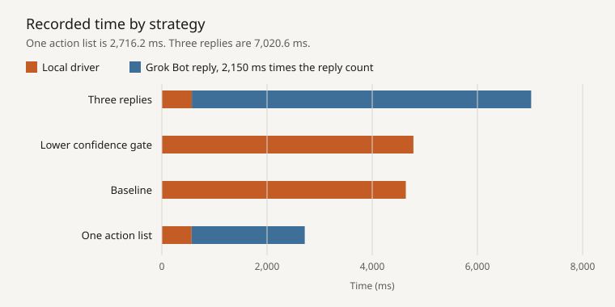

# Laya computer-use driver

This local service uses three layers:

1. Playwright performs browser navigation, clicks, typing, and key presses.
2. Laya proposes fast typed actions from the indexed DOM.
3. Grok Bot decides any action whose Laya confidence is below `0.35`, writes text, and confirms completion. Check, uncheck, and select run locally when that confidence is met and the control is unambiguous.

Low-confidence actions are never clicked automatically. Password, payment, deletion, and similar controls require explicit confirmation.

## Start

```powershell
.\serve.ps1
```

Leave the terminal and opened Chromium window running. Browser state is stored under `profile/`.

## Configure Grok Bot

Print the current instructions and paste the complete output into Grok Bot:

```powershell
.\.venv\Scripts\python.exe -m driver prompt
```

Grok Bot must have local computer execution enabled. It calls only the localhost service and should not use its cloud computer-use helper for these tasks.

## Driver states

- `needs_text`: Grok supplies text for the requested field.
- `needs_action`: Grok chooses an indexed action because Laya was uncertain.
- `needs_confirm`: the user must approve a sensitive action.
- `blocked`: login, captcha, or missing control needs intervention.
- `done`: the task is complete.
- `error`: preserve and report the complete `error` field.

The service listens only on `127.0.0.1:8765` and requires the bearer token in `.token`.

## API additions

- `GET /elements?query=...` returns the full element list and the page text.
- `GET /screenshot` returns the latest PNG.
- Choice packets include `id`, `role`, `name`, `value`, `checked`, `selected`, `disabled`, and `href` only when a control has one. Page text is empty until `action=read`.
- `/reply` accepts `actions`, a list of up to 8 actions for the current page. One `action` field still works. The list stops when an element is missing, the page changes, or a sensitive control needs confirmation.
- `/reply` actions: `click`, `type`, `select`, `press`, `check`, `uncheck`, `scroll`, `upload`, `read`, `wait`, `navigate`, `new_tab`, `switch_tab`, `close_tab`, `done`, `blocked`, and `abort`. `press_enter` remains supported.
- `type` and `needs_text` replies accept `submit: true`.
- `/task` accepts `max_steps`, `observe_cap`, and `element_limit`. A new task replaces the previous one and does not click. Omitting `url` keeps the current page unless the goal itself contains a URL. Laya's done and blocked opinions wait for a reply.

Examples:

```json
{"actions":[{"action":"uncheck","element_id":"2"},{"action":"select","element_id":"3","label":"Resume A"}]}
{"action":"select","element_id":"12","label":"Australia"}
{"action":"press","element_id":"17","key":"ArrowDown"}
{"action":"scroll","element_id":"23","amount":700}
{"action":"new_tab","url":"https://example.com"}
```

## Measured times



Baseline and the lower confidence gate used an instant stand-in, so those bars have no Grok segment. The five driver iterations were:

| Strategy | Driver time each run (ms) | Median (ms) |
|---|---|---:|
| Three replies | 606.6, 580.3, 567.2, 566.1, 570.6 | 570.6 |
| One action list | 566.2, 576.5, 577.2, 561.6, 560.6 | 566.2 |

Every recorded run, including the single-run strategies and the local model calls, is in [`benchmarks/timings.json`](benchmarks/timings.json).

## Verification

The automated checks cover labelled and unlabelled fields, modal priority, field state, stable IDs, narrowing, UTF-8, reading, form submission, select/press/check/scroll/upload actions, tabs, screenshots, errors, stale controls, task replacement, navigation recovery, and request limits.
